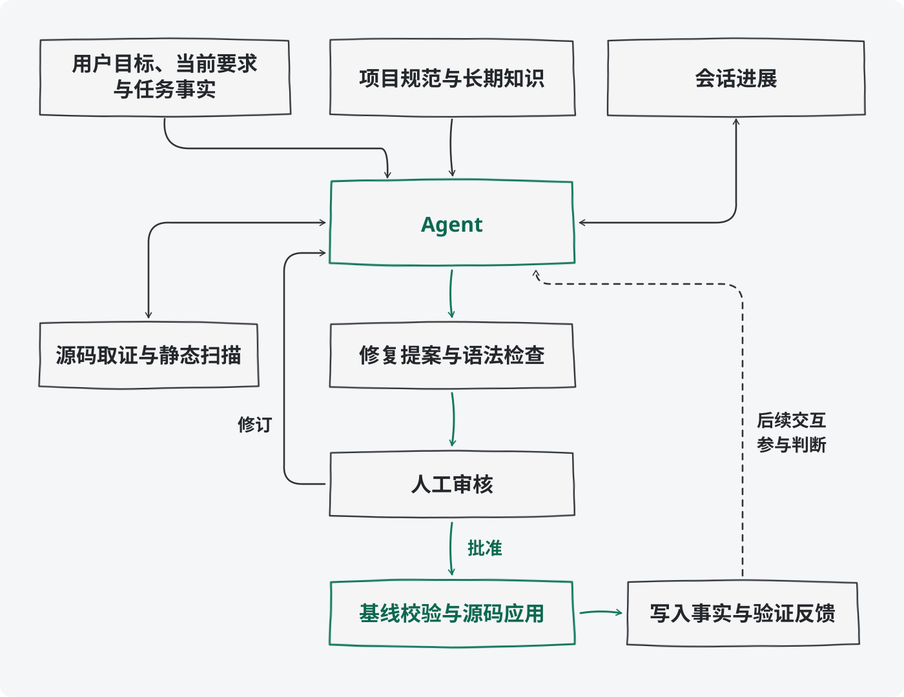

<h1 align="center">AutoPatch-J</h1>

<strong>面向企业 Java 仓库的 Coding Agent</strong>

结合静态分析与大模型代码理解，交付可审核、可验证的补丁。

AutoPatch-J 通过本地 CLI 提供代码审阅、项目问答和交互式修复。Agent 从扫描告警或开发者指出的问题出发，结合项目规范和长期项目知识调查源码、分析修改影响，并提出修复方案。

  <a href="#harness-engineering模型决策与确定性执行">Harness Engineering</a> ·
  <a href="#context-engineering围绕问题组织上下文">Context Engineering</a> ·
  <a href="#tool-use让修复判断建立在代码证据上">Tool Use</a> ·
  <a href="#agent-memory沉淀并复用项目知识">Agent Memory</a> ·
  <a href="#loop-engineering持续调查与长任务续接">Loop Engineering</a> ·
  <a href="#human-in-the-loop补丁评审与受控执行">Human-in-the-loop</a>

## Harness Engineering：模型决策与确定性执行

> **Agent = LLM + Harness Engineering**

AutoPatch-J 围绕调查、提案、审核和应用组织 Agent Harness：模型负责调查与修复决策，多文件改动先形成完整提案；开发者确认具体版本后，程序核对全部目标文件的源码基线，再按批准范围逐文件写入。

  
   
  <a href="docs/assets/AUTOPATCH_J_ARCHITECTURE.svg">查看架构原图</a>

## Context Engineering：围绕问题组织上下文

system prompt 定义审阅策略和修复原则，运行时加入项目规范与当前任务上下文。当前目标、有效要求、写入范围和提案标识在每次主模型请求中单独提供；调查历史可以压缩，当前任务仍以独立保存的状态为准。

上下文按调查需要逐步补充：从问题附近的关键代码出发，再扩展到相关方法、类型和调用方。围绕影响当前判断的证据组织上下文，减少无关代码和过期要求对模型的干扰。

## Tool Use：让修复判断建立在代码证据上

Semgrep 提供扫描线索，Tree-sitter 定位方法、类型和引用线索。Agent 通过工具读取当前源码，核实方法的使用条件，并调查受影响的关联代码。

以 `Optional.get()` 告警为例，调用方可能通过捕获 `NoSuchElementException` 处理缺失值，直接改为返回默认值会改变这段行为。Agent 需要调查普通调用和 `store::load` 这类方法引用，核实调用约定后再准备修复；同名的 `AtomicInteger.get()` 则要结合所属类型区分。证据不足时继续取证或说明缺口。

## Agent Memory：沉淀并复用项目知识

采用“主笔记＋主题知识”的分层记忆。主笔记自动加入上下文，保存精简的项目约定和主题入口；详细知识由 Agent 按需读取、核实和更新。

项目规范、长期知识与本次任务要求分别管理。会话记录当前调查进展，长期笔记供同一项目的后续任务复用，临时要求只作用于当前任务。易变的代码信息在使用前重新核对，影响当前修复的冲突则在对话中澄清。

## Loop Engineering：持续调查与长任务续接

一次交互可以包含多轮取证与工具调用。Agent 根据返回的证据调整下一步，在“调查 → 判断 → 行动 → 反馈”之间迭代；需要人工授权或评审时，交回开发者继续决定。

长任务通过结构化增量摘要保留目标、已作决策、关键代码位置和下一步，每次基于已有摘要继续更新，同时保留近期交互和工具调用关系。审核状态和写入进度独立于对话历史保存，为后续执行提供依据。

循环检测用于提醒 Agent 调整重复行为；达到请求上限时停止本轮运行。已保存的会话与任务状态支持跨次续接，开发者可以在后续交互或下次启动后继续同一任务。

## Human-in-the-loop：补丁评审与受控执行

源码读取范围与修改权限分开管理，Agent 可以充分调查关联代码，再申请必要的修改范围。同一问题的多文件改动作为完整提案展示，开发者通过 diff 和修改理由讨论、修订并确认方案。

补丁准备阶段检查 Java 语法，应用前校验源码基线，只写入已确认的版本。有绑定扫描目标时，应用后复扫对应目标区域。写入进度与验证结果在后续交互中返回 Agent，供它判断修复效果、继续调整。交付时说明实际生效的修改、目标复扫结论和未验证项。

## 工程效能与未来展望

未来将 AutoPatch-J 接入现有 CI/CD 流水线，修复结果以可评审的 MR/PR 交付。代码修复也将从零散的人工作业，变成随流水线持续运行、可跨项目复用的工程能力。

同时，计划支持更多编程语言，接入不同语言生态中的静态分析工具，将代码取证、AI 判断、补丁生成与审核验证能力扩展到更多工程场景。

  
   
  <a href="docs/assets/AUTOPATCH_J_CICD_WORKFLOW.svg">查看展望原图</a>

安装、配置与日常操作见[使用手册](docs/GETTING_STARTED.md)。
