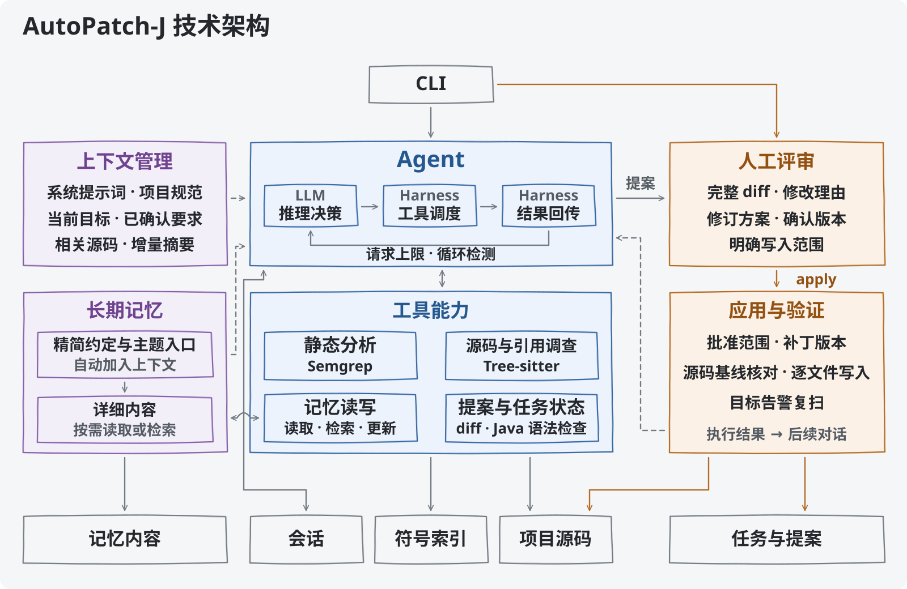
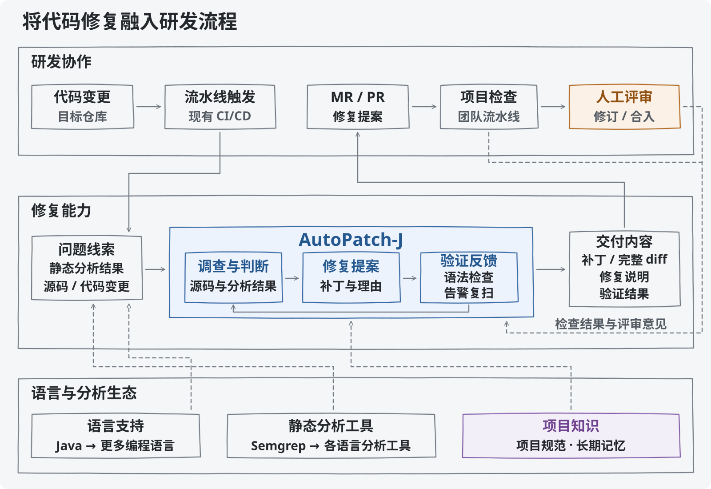

<h1 align="center">AutoPatch-J</h1>

<strong>面向企业 Java 仓库的 Coding Agent</strong>

结合静态分析与大模型代码理解，交付可审核、可验证的补丁。

AutoPatch-J 通过本地 CLI 提供代码分析、项目问答和交互式修复。Agent 从扫描告警出发，结合项目规范和长期项目知识调查源码、分析修改影响，并提出修复方案。

  <a href="#harness-engineeringagent-运行编排与执行约束">Harness Engineering</a> ·
  <a href="#context-engineering任务上下文的按需组装">Context Engineering</a> ·
  <a href="#agentcomputer-interfaceaci面向-agent-的工具设计">ACI</a> ·
  <a href="#agent-memory长期记忆的渐进式披露">Agent Memory</a> ·
  <a href="#loop-engineering长任务推进与反馈纠偏">Loop Engineering</a> ·
  <a href="#human-in-the-loop补丁评审与受控执行">Human-in-the-loop</a>

  <a href="docs/PYTHON_STYLE.md">代码规范</a> ·
  <a href="docs/GETTING_STARTED.md">使用手册</a>

## Agent 工程设计

> **Agent = LLM + Harness Engineering**

  

### Harness Engineering：Agent 运行编排与执行约束

Harness 将模型调用、工具执行、上下文和记忆组织成持续推进任务的运行机制。LLM 根据当前证据选择工具、提出修复方案，Harness 调度工具执行，再将结果交回 LLM，供其判断下一步行动。AutoPatch-J 将任务状态、人工批准和源码写入交由程序独立管理，区分模型提出的方案与实际执行结果。

### Context Engineering：任务上下文的按需组装

上下文工程要在有限的上下文窗口中，为 LLM 提供当前任务所需的证据、必要的历史记录和仍然有效的任务要求。AutoPatch-J 按需读取源码与项目知识，最近的对话及工具调用记录保留原文；较早的调查记录通过增量摘要整理，将新证据合并到已有摘要中，并更新结论，保留关键决策和未决问题。当前目标、修改范围和用户已确认的要求由程序单独维护，在 LLM 分析当前任务时提供。

### Agent–Computer Interface（ACI）：面向 Agent 的工具设计

ACI 从 LLM 使用工具的角度设计接口，明确每个工具承担什么任务、允许哪些操作，以及返回什么信息。AutoPatch-J 按调查任务组织工具，一次告警详情查询同时返回告警位置、当前源码和适用规范，供 LLM 判断问题是否成立，并决定是否继续追查关联代码。

### Agent Memory：长期记忆的渐进式披露

AutoPatch-J 的长期记忆采用渐进式披露：精简的项目约定和主题入口自动加入上下文，相关主题的详细内容由 LLM 通过工具按需读取或检索。Agent 在处理任务时整理用户确认的长期约定和已核实的项目知识，优先更新已有内容。本次任务的分析过程和讨论记录保留在会话中，涉及源码现状的记忆内容在使用前重新核实。

### Loop Engineering：长任务推进与反馈纠偏

LLM 结合新获取的源码证据、工具结果和人工反馈，决定继续调查、修订方案或提交评审。Harness 在运行中识别重复调用、重复结果等停滞迹象，将具体的重复行为反馈给 LLM，提示它改变调查方式或说明遇到的阻碍。调查进展保留在会话中，提案、源码写入和验证状态独立记录，在后续分析时提供给 LLM。

### Human-in-the-loop：补丁评审与受控执行

Agent 可以在仓库内调查关联代码，实际写入范围由开发者批准。同一问题涉及的多文件改动作为完整提案提交评审，批准只对评审过的补丁版本和修改范围生效。应用补丁前，程序核对源码是否发生变化；补丁或源码变更后，不能直接沿用原来的批准。

## 工程效能与未来展望

未来将 AutoPatch-J 接入现有 CI/CD 流水线，修复结果以可评审的 MR/PR 交付。代码修复将随流水线持续运行，团队可以在不同项目中复用这套修复能力。

同时，计划支持更多编程语言，接入不同语言生态中的静态分析工具，将代码取证、AI 判断、补丁生成与审核验证能力扩展到更多工程场景。

  

