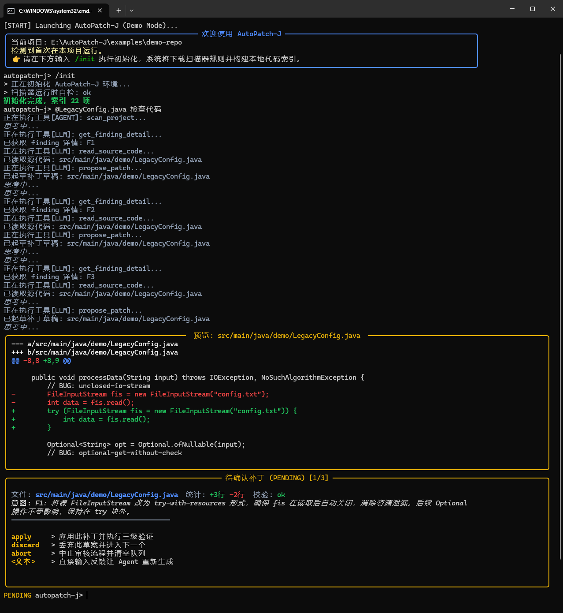

# AutoPatch-J 上手与操作手册

这里集中说明 AutoPatch-J 的安装、配置和日常操作。项目定位见 [README](../README.md)，行为契约和代码依据统一见 [SPEC](SPEC.md)。

## 1. 环境要求

- Python `3.14+`
- 待检查的 Java 仓库
- OpenAI 兼容的 LLM API
- 安装 Python 依赖和 managed Semgrep runtime 所需的网络环境

目前实际使用的扫描器是 Semgrep，`/scanner` 仅显示已经实现的扫描器。其他接入方向见 README 展望。

## 2. 安装

在 AutoPatch-J 仓库根目录创建虚拟环境，并以 editable 模式安装项目。

macOS / Linux：

```bash
python3 -m venv .venv
source .venv/bin/activate
python -m pip install -c constraints.txt -e .
```

Windows PowerShell：

```powershell
python -m venv .venv
.\.venv\Scripts\Activate.ps1
python -m pip install -c constraints.txt -e .
```

安装完成后可以运行 `autopatch-j`，也可以使用 `python -m autopatch_j`。

## 3. 配置 LLM

配置必须存在于启动 CLI 的进程环境中。AutoPatch-J 不会自动读取 `.env`。`AUTOPATCH_LLM_API_KEY` 必须设置，`AUTOPATCH_LLM_BASE_URL` 和 `AUTOPATCH_LLM_MODEL` 有默认值。

macOS / Linux：

```bash
export AUTOPATCH_LLM_API_KEY="your-api-key"
export AUTOPATCH_LLM_BASE_URL="https://api.deepseek.com"
export AUTOPATCH_LLM_MODEL="deepseek-flash"
```

Windows PowerShell：

```powershell
$env:AUTOPATCH_LLM_API_KEY="your-api-key"
$env:AUTOPATCH_LLM_BASE_URL="https://api.deepseek.com"
$env:AUTOPATCH_LLM_MODEL="deepseek-flash"
```

完整环境变量、默认值和校验规则见 [SPEC 配置](SPEC.md#61-配置与协议)。`AUTOPATCH_DEBUG=true` 开启调试，`AUTOPATCH_AUDIT_BATCH_LIMIT` 控制每轮 finding 数量。

使用内置 `deepseek-flash` 或 `deepseek-v4-pro` 时，应用已经定义 context profile，不接受容量覆盖。使用其他模型时，必须根据实际模型能力同时设置正整数 `AUTOPATCH_LLM_CONTEXT_WINDOW` 与 `AUTOPATCH_LLM_MAX_OUTPUT_TOKENS`，且为输入保留安全余量；缺失或不合法会报告配置错误。应用只支持标准 Chat Completions function-call 协议，协议、流解析和 reasoning 回传由 Pydantic AI 与原生 SDK 处理，请求策略按任务用途固定。

## 4. 在 Java 仓库中启动

先激活安装了 AutoPatch-J 的虚拟环境，再进入待检查的 Java 仓库。CLI 会把启动目录当作项目根目录。

```bash
cd /path/to/your-java-repository
autopatch-j
```

也可以使用模块入口：

```bash
python -m autopatch_j
```

第一次进入项目时执行：

```text
/init
```

`/init` 会初始化项目运行环境、清空原有补丁审核工作台、安装或检查 managed Semgrep runtime，并重建 Java 符号索引。完成后可以用 `/status` 和 `/scanner` 检查状态。

### 运行内置 demo

仓库中的启动脚本会创建 `.venv`、安装当前项目，然后进入 `examples/demo-repo` 启动 CLI。运行前需要先设置 `AUTOPATCH_LLM_API_KEY`。

macOS：

```bash
./run_on_macos.sh
```

Windows：

```bat
run_on_windows.bat
```

macOS 脚本会在启动前准备 managed Semgrep runtime。Windows 脚本启动 CLI 后，还需要执行 `/init` 来准备扫描器和索引。

## 5. 第一次审计

在指令中用 `@` 指定 Java 文件或目录：

```text
@src/main/java 检查这个目录中的安全问题
@src/main/java/demo/AppConfig.java 审计这个文件并给出修复建议
```

如果只输入 `@路径`，CLI 会提示继续输入具体要求。收到完整指令后，系统解析检查范围、执行 Semgrep，并把合法的扫描结果加入 finding 队列。每轮最多处理的数量由 `AUTOPATCH_AUDIT_BATCH_LIMIT` 控制。

Agent 会为当前 finding 准备候选补丁。CLI 展示目标文件、diff、修改理由和语法检查结果，然后把补丁放入审核队列。在用户应用、丢弃或中止之前，CLI 会一直显示当前补丁。



## 6. 审核补丁

看到补丁预览后，可以直接输入：

| 输入 | 结果 |
|---|---|
| `apply` | 应用当前补丁，重新检查目标 finding，然后进入下一项 |
| `discard` | 丢弃当前补丁，然后进入下一项 |
| `abort` | 结束本轮审核并丢弃剩余补丁 |

决定之前也可以继续提问或要求修改：

```text
解释为什么要这样修改
把判空改成 Objects.equals 的写法
这个修改会影响哪些调用方？
```

补丁解释围绕当前待审项，修订只能替换当前文件和 finding，仍须与当前绑定区域相交，不能切换到同文件其他 finding。绑定校验失败时原补丁不变；语法检查结果会随预览显示，不等于目标项目编译或测试通过。

如果同一文件还有其他待审补丁，前一个补丁可能会改变它们的位置。系统会更新不重叠补丁的位置；无法重新定位的补丁会显示 `STALE_DRAFT`。这类补丁不能继续 apply 或 revise，可以选择 `discard`，也可以 `abort` 后按当前源码重新扫描。

补丁应用后会得到以下结果之一：

- `RESOLVED`：修改后的位置不再触发同一条规则。
- `STILL_PRESENT`：修改后的位置仍然触发该规则。
- `UNVERIFIED`：扫描器不可用，或者缺少可靠的补丁应用记录，无法确认补丁仍对应原 finding。

如果结果是 `STILL_PRESENT` 或 `UNVERIFIED`，已经应用的补丁不会自动回滚。

## 7. 代码解释与普通问答

除了审计，也可以让 AutoPatch-J 解释代码或回答工程问题：

```text
@src/main/java/demo/AppConfig.java 解释这个类的职责
为什么这里适合使用不可变对象？
```

普通问答和代码解释会保存完整 SDK 会话，重启后可继续。代码审计、零 finding 复核、补丁解释与修订使用独立历史；各任务可读取本项目长期笔记。需要记住已确认的长期偏好或决定时，可以明确要求 Agent 写入笔记。详见 [会话与 Memory 规格](SPEC.md#7-项目-memory)。

## 8. CLI 命令

| 命令 | 作用 |
|---|---|
| `/init` | 初始化当前 Java 项目，准备扫描器并建立索引 |
| `/status` | 查看项目状态和运行诊断 |
| `/scanner` | 查看扫描器状态 |
| `/reindex` | 重建 Java 符号索引 |
| `/reset` | 重置扫描、索引与审核工作台；保留会话、笔记、导出和终端历史 |
| `/new` | 归档当前普通会话、开启空会话，清理待审草案并保留笔记 |
| `/memory ...` | 查看和管理项目级 Memory |
| `/help` | 显示命令和交互关键字 |
| `/quit` | 关闭模型客户端及运行资源后退出 |

### Memory 子命令

| 命令 | 作用 |
|---|---|
| `/memory status`、`list` | 读取当前项目笔记文件列表 |
| `/memory show [path]` | 查看笔记内容，默认 MEMORY.md |
| `/memory forget <path>` | 删除笔记文件；MEMORY.md 受保护，使用明确自然语言修订或 clear |
| `/memory clear --confirm` | 清空项目笔记，保留普通会话、导出和终端历史 |
| `/memory export` | 创建现有笔记的 JSON 导出，不覆盖旧文件 |

普通会话保存在 `.autopatch-j/conversations.sqlite3`，长期笔记保存在 `.autopatch-j/memory.sqlite3`。删除笔记不会擦除普通会话中的旧内容；如需开始独立对话，使用 `/new`。导出仅含 notebook 文件，不是完整对话或 RAW 审计记录。

旧 memory.db、memory_summary.md 不再作为输入，也不会自动迁移或删除；如有需要可自行备份查看。项目不再生成 Markdown 审阅投影，也没有后台 Memory 提取任务。

## 9. 常见问题

### CLI 提示“系统未初始化”

在目标 Java 仓库中执行 `/init`。源码变化较大、索引需要更新时，可以执行 `/reindex`。

### `.env` 中有 API Key，CLI 仍提示缺少配置

AutoPatch-J 不读取 `.env`。请把变量设置到启动 CLI 的 shell 或系统环境中，然后重启进程。

### LLM 返回 401、403 或 404

- `401`：检查 `AUTOPATCH_LLM_API_KEY`。
- `403`：检查账号是否有权使用当前 LLM，以及账户余额和供应商访问策略。
- `404`：检查 `AUTOPATCH_LLM_BASE_URL` 和 `AUTOPATCH_LLM_MODEL`。

需要查看 LLM 服务返回的原始错误时，设置 `AUTOPATCH_DEBUG=true` 并重启 CLI。错误正文可能包含敏感信息，分享前需要检查。

### 扫描器不可用或扫描失败

先执行 `/scanner` 查看状态，再用 `/init` 检查 managed Semgrep runtime。Semgrep 返回的数据缺少必要字段、包含错误或 finding 位置无效时，AutoPatch-J 会中止本次扫描，不会把结果当作零 finding。

### 当前补丁显示 `STALE_DRAFT`

这表示当前源码已经无法和补丁保存的位置可靠对应，或上次应用的最终审核状态未能保存。选择 `discard` 丢弃当前项，或者 `abort` 后重新扫描；不要继续应用这份草案。

### 提示“源码已写入，但审核状态未保存”

源码修改已经生效，请先核对文件。程序保留了失效草案，重启后也会阻止重复应用；选择 `discard` 或 `abort` 后重新扫描。不会自动回滚、重试 apply 或继续复扫。若连写入前的阻断状态也无法保存，则不会写源码。

### 笔记或普通会话存储不可用

存储异常会明确提示。笔记加载失败时，主任务可继续，但本轮不能据此判断“没有项目笔记”；普通回答已经生成而保存失败时，回答仍显示，并提示会话未保存。并发冲突不会覆盖其他进程的修改。

先保存需要保留的输出，并检查项目状态目录的权限和存储情况；不会自动迁移或重建损坏的数据库。`/memory clear --confirm` 只用于明确删除当前笔记，不承诺修复任意数据库损坏。

### 模型响应不完整或请求达到上限

异常 finish reason 或缺少流结束标记会使本轮失败，不会执行该响应工具或提交未完成草案。额度或循环限制产生的有效草案仍可进入人工审核；界面会区分任务受限和完整完成。必要上下文过大时缩小范围，或使用 `/new` 开始新普通会话。

## 10. 开发与测试

开发安装、Python 规范和静态检查命令统一见 [Python 规范：安装与检查](PYTHON_STYLE.md#3-安装与检查)。仅运行测试时也可按 [AGENTS](../AGENTS.md#实现与验证) 安装测试依赖。

运行确定性完整回归：

```bash
pytest -q
```

默认回归不调用真实 LLM。测试执行、真实 LLM 授权和开发协作规则统一见 [AGENTS](../AGENTS.md#实现与验证)，产品侧测试隔离契约见 [SPEC](SPEC.md#8-验证契约与能力限制)。
